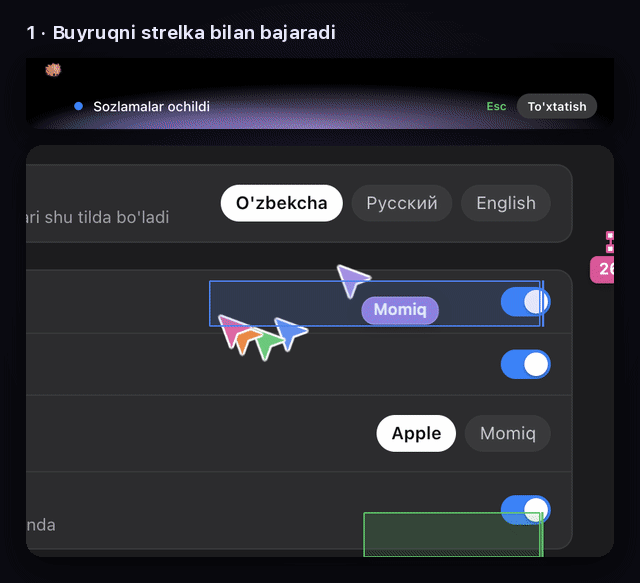
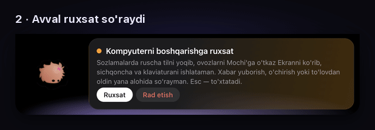
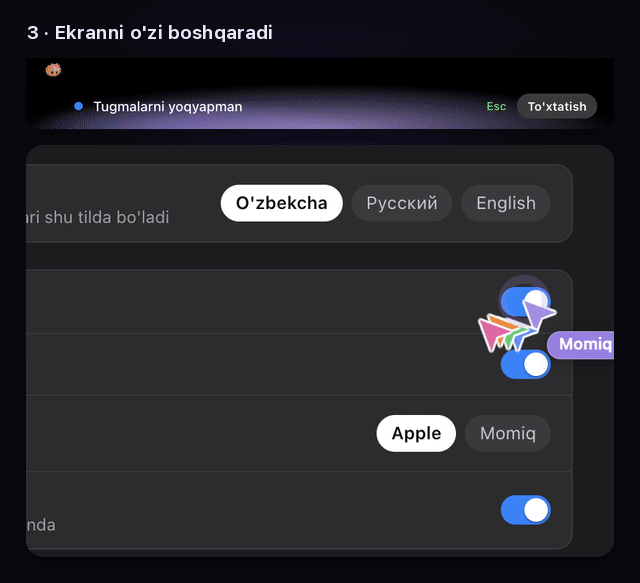

# Momiq — ochiq yuklamalar

    
    
  

Bu repoda Momiq ilovasi o'zi yuklab oladigan fayllar turadi (kod yo'q):

- `models/v1/` — oflayn nutq modellari (o'zbekcha RubaiSTT va ko'p tilli Whisper Small), 90 MB lik bo'laklarga bo'lingan; `manifest.json` da har bo'lak va butun faylning SHA-256 xeshi. Litsenziyalar: `models/v1/NOTICE.md`.
- `updates/` — Momiq kod yangilanishlari: `momiq-update-<asos>.json` lentasi va imzolangan (Ed25519) `.upd.gz` to'plamlari. Ilova har bir to'plamni yozishdan oldin xesh va imzo bilan tekshiradi.

Momiq modellarni avval asl manbadan (Hugging Face, tezroq) yuklaydi; u ishlamasa — shu repodagi bo'laklardan.
